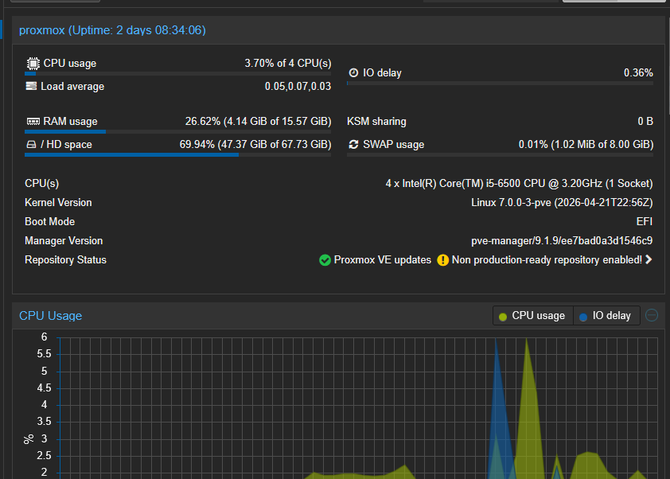

This is my personal homelab, built to experiment with networking, system administration, virtualization and cybersecurity. It is meant to be a place where I can deploy new services, gain hands-on experience and break things without affecting anything overly sensitive.

## Current Services
- Debian 13 LXC Samba Server: Network-attached storage (NAS)
- Pi-hole: Network-wide DNS filtering and ad blocking
- Ubuntu LXC (ROCm): Container designed for experimenting with offline large language models, video encoding, and similar GPU-based experiments. This one usually remains off until I need it due to my limited amount of DRAM.
## Hardware Specifications
- CPU: Intel Core i5-6500 (4 cores / 4 threads)
- Memory: 16 GB DDR4 (I plan on upgrading once RAM prices calm down)
- Boot Drive: 150 GB SSD
- Mass Storage: 8 TB HDD
- GPU: AMD Radeon RX 7800 XT (used for experimenting with local LLMs, GPU acceleration, and video encoding)

>**Fun Fact:** This is my old gaming PC. I have owned it since I was about 8 or 9 years old, and it has been with me since the very beginning! From installing Linux at 9, compiling Gentoo at 11, to completing my first CTF challenge at 12.
>
>Over letting "Ol Reliable" become e-waste, I decided to give it a second life as my homelab.

## Upgrades I wish to make
Some upgrades I plan on doing in the future:
- More DRAM, as 16 GB is cutting it close to what I need and I wish to make an active directory lab later on (Not until prices calm down because unfortunately an extra 16 GB of DDR4 is roughly 600 Canadian Dollars at the time of writing)
- A managed switch, to play with VLANs and possibly add more nodes to proxmox