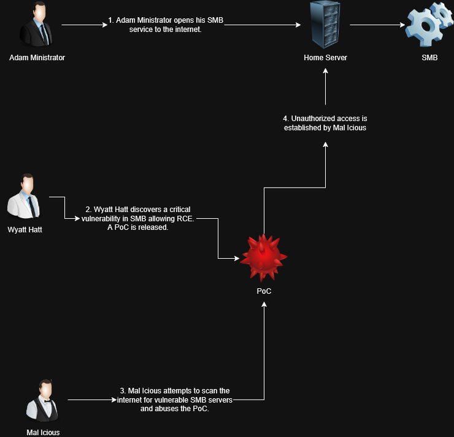
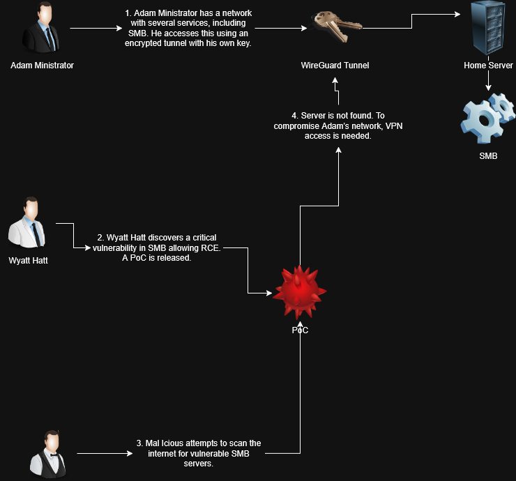

Occasionally, you will need to access a server you are running on your homelab whilst you are away from home.

Two common approaches achieve this:

- Port Forwarding every port you need (I advise against this, see below)
- Using a VPN connection 

## Why a VPN connection?

Using a VPN connection is desirable because port forwarding increases attack surface and your risk of opportunistic attacks.

For example:

1. Adam Ministrator opens his SMB service to the internet.
2. Later on, Wyatt Hatt, an ethical hacker, finds a vulnerability in SMB that allows an attacker to run code remotely on an SMB server. 
3. To demonstrate the vulnerability, Wyatt Hatt releases a "Proof of Concept" (PoC), a script that showcases how the vulnerability works.
4. Upon release of this, Mal Icious discovers the PoC and scans the internet with automated tools to find SMB services. Mal Icious then utilizes the PoC to gain unauthorized access to the vulnerable device.



With access to Adam Ministrator's server, Mal can do the following:
- Enumerate and attack other services on the same network to move laterally
- Steal credentials present on the server
- Install backdoors or malware
- Compromise personal data and use it to extort Adam.
This happened in 2017 during the WannaCry ransomware attack, where exposed services were attacked once the NSA's exploit was leaked by the Shadow Brokers.

Please note that I used SMB as an ***extreme example*** because it is commonly targeted and typically **should never be exposed directly to the internet.**

Now, let's look at the same scenario using a VPN:
1. Adam Ministrator has a network with several services, including SMB. He accesses this using an encrypted tunnel with his own key.
2. Wyatt Hatt releases a PoC for an SMB vulnerability that allows remote code execution.
3. Mal Icious attempts to scan the internet for vulnerable SMB servers. Adam's server is not publicly accessible, meaning it will not be found or attacked by Mal.
4. To compromise Adam's SMB service, Mal must gain access to the VPN. This could be achieved by stealing Adam's VPN credentials through phishing, malware, or another social engineering attack, or by exploiting a previously unknown vulnerability in the VPN software. 


Do note that port forwarding itself isn't insecure, many public services, such as websites require it. But it's not really necessary for a home network and for important services like SMB, a domain controller or a proxmox dashboard, a VPN is safer and simpler.

Along with this, public-facing services are usually behind a DMZ (Demilitarized Zone), which ***I will cover in a later homelab writeup.***

## Software used and why
For this project, I decided to use the following software.

| Software     | Reason behind it                                                                                                                                                                                                                                                                                                                                                                                                                                                      | Role                |
| ------------ | --------------------------------------------------------------------------------------------------------------------------------------------------------------------------------------------------------------------------------------------------------------------------------------------------------------------------------------------------------------------------------------------------------------------------------------------------------------------- | ------------------- |
| Alpine Linux | Alpine Linux is a lightweight distro with a small installation. The smaller footprint reduces my RAM usage (as I only have 16 GB on the host in total) and attack surface, making it ideal for a VPN server. OpenBSD is also a good option for similar reasons, however I chose Linux primarily because I have more experience using and configuring it. I will also use this as an exit node, so I can access the internet from our home's connection from anywhere. | LXC Guest/Exit Node |
| Tailscale    | Tailscale provides secure access using WireGuard, while managing peers, NAT traversal, authentication and more. For my personal homelab, it reduces complexity while still providing the same security benefits as a VPN.                                                                                                                                                                                                                                             | VPN Server/Client   |

The best solution isn't always "minimal", it's typically (but not always) the one with the least overhead or difficulty.

**Fun Fact:** Tailscale is a Canadian product, with its headquarters in Ottawa!


## When you shouldn't use Tailscale (and use WireGuard instead)
While Tailscale is great for many smaller uses, there's a few situations where I would consider "traditional" WireGuard is more appropriate.
* High security environments
	* While Tailscale is incredibly trusted by many organizations, such as Nvidia, SpaceX and Instacart. if you are following strict compliance rules, handling incredibly sensitive or classified info, or do not trust proprietary software: WireGuard is more appropriate. 
* You require or want a fully self-hosted solution
	* Some people prefer manually configuring and managing peers, keys, and other WireGuard settings without relying on a third-party control plane
* You are connecting a small number of servers with static IP addresses
	* If only a handful of systems need to communicate with each other, a direct WireGuard config may be simpler and have less attack surface over introducing a third-party.
* You are working with isolated labs or DMZs
	* Networks that are intended to be isolated from external services (such as malware labs) may benefit from traditional WireGuard. This helps maintain complete control over the environment and reduce risks.

The choice between WireGuard and Tailscale depends on your requirements and preference. Tailscale is significantly simpler and easier to setup, but WireGuard provides the most transparency and control.

Alternatively, if you want control and transparency but are running a large organization, OpenVPN may be a better fit due to its native support for Microsoft Active Directory via LDAP, allowing you to manage thousands of users easily; at the cost of a larger attack surface, heavier battery usage and more complex setup. 
## Initial Setup and Preparation

### Mapping mesh network
First, let's map our network and determine what should be added to our mesh network.

For me, there's only a small amount of servers that should be added:

1. Proxmox Web Panel (For managing VMs, host updates, etc)
2. My main PC (Playing games and editing video on my ThinkPad over Moonlight, VMWare Workstation over RDP, local LLM usage)
3. SMB Server (For file sharing)
4. Exit Node (A lightweight alpine VM, so I can access the internet as if I was at home using my home IP; such as accessing my bank, as my bank doesn't allow VPN logins to prevent fraud. Peer relay is used to bypass when DERP servers are blocked or for when I want higher speeds.)

And now, the devices I will be accessing the mesh network from (our clients):
1. My Pixel 10 phone
2. Thinkpad T14 Gen 2

Tailscale used to give us only 3 users and 100 devices on the free plan, however that has extended to 6 users and unlimited devices (tagged devices are limited to 50, with an extra dollar per extra tagged device), so we have a ton of headroom.


### Install
To install Tailscale, it's incredibly simple and straightforward.
Go to the website, create an account, download the software, login and you're done.

### Creation of our exit node
To create our exit node, we install Tailscale onto our Alpine container then login.
Then, to actually make it advertise itself as an exit node, we must tell tailscale that this is one.
```
apk add nftables iproute2 # These packages will tell eth0 what to route and where, nftables is what is recommended by the alpine team, instead of iptables

echo 'export TS_DEBUG_FIREWALL_MODE=nftables' >> /etc/conf.d/tailscale 

# Tell tailscale to use nftables for the rules
rc-service tailscale restart # Restart the tailscale service

tailscale set --advertise-exit-node
```

Once that is completed, approve it on your Tailscale dashboard. 
We're not done yet though. IP forwarding needs to be enabled for us to actually use the exit node. Basically, IP forwarding allows the LXC container to route packets; in our case, route them to our home router which routes them to the internet.

We can do this using the following commands as root.
```
echo 'net.ipv4.ip_forward = 1' | tee -a /etc/sysctl.conf
echo 'net.ipv6.conf.all.forwarding = 1' | tee -a /etc/sysctl.conf # Required only if you want to use ipv6 forwarding
sysctl -p /etc/sysctl.conf

rc-update add sysctl boot # make sure it applies those commands each boot
```
Reboot and you're done!
You've now set up Tailscale successfully!
